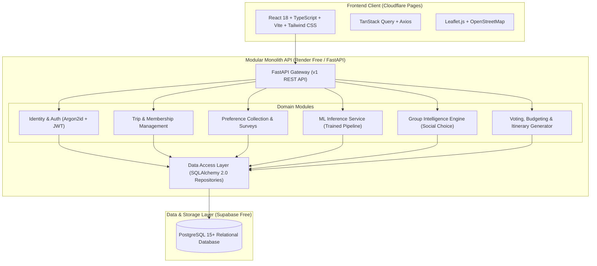

# TripSync AI ✈️🌍
> **Enterprise-Grade AI-Powered Collaborative Group Travel Planning Platform**

TripSync AI solves the fundamental challenge of group trip planning: reconciling divergent budgets, conflicting interests, and varied travel styles among multiple participants into a cohesive, optimized, and mutually satisfying group itinerary.

---

## 🌟 The Core Problem & Solution

Planning group travel is notoriously friction-heavy:
- **Asymmetric Preferences:** Group members have polarized budgets, pacing desires (relaxed vs. fast-paced), and conflicting activity preferences (nature vs. nightlife vs. culture).
- **Social Choice Stalemate:** Traditional voting often creates extreme dissatisfaction for the minority or leads to analysis paralysis.
- **Disconnected Tools:** Notes, split-expense spreadsheets, chat threads, and booking links are fragmented across multiple apps.

**TripSync AI introduces a Dual-Engine Decision Architecture:**
1. **Empirical ML Inference Engine:** A trained machine learning model mapping individual and collective preference profiles to destination and attraction affinity scores based on real-world travel datasets.
2. **Group Intelligence Engine:** A social choice aggregator applying axiomatic decision rules (Borda count, Least Misery egalitarian ranking, and Nash bargaining principles) with conflict detection to maximize group satisfaction while protecting individual minimum utility.

---

## 🏛️ System Architecture

TripSync AI is implemented as a **Domain-Centric Modular Monolith** designed for high cohesion, low coupling, and zero-cost hosting feasibility without microservice overhead.



---

## 🛠️ Technology Stack

| Domain | Technology | Justification |
| :--- | :--- | :--- |
| **Frontend** | React 18, Vite, TypeScript, Tailwind CSS, Leaflet.js, Recharts | Type-safe, ultra-fast client-side rendering, zero build-bundle bloat, native interactive maps. |
| **Backend** | Python 3.11, FastAPI, Pydantic v2, SQLAlchemy 2.0, Alembic | Async performance, strict schema validation, robust ORM migrations, auto-generated OpenAPI. |
| **Machine Learning** | NumPy, Pandas, Scikit-Learn, LightGBM, Joblib | Light memory footprint (<25 MB serialized), reproducible pipeline, mathematical and library implementations. |
| **Database** | PostgreSQL 15+ (Hosted on Supabase Free Tier) | ACID compliance, JSONB document flexibility, relational integrity for group memberships. |
| **DevOps & Hosting** | Docker, GitHub Actions, Render (API), Cloudflare Pages (SPA) | Zero-cost (₹0 budget), automated linting, unit tests, and continuous deployment. |

---

## 📅 35-Day Development Roadmap

| Phase | Milestone | Target Day | Core Focus |
| :--- | :--- | :--- | :--- |
| **Phase 1** | **Working MVP & Public Deployment** | **Day 18** | Data engineering, real-world ML model training, FastAPI backend, React UI, group preference surveys, AI recommendations, collaborative voting, budget/itinerary tools, public cloud deployment. |
| **Phase 2** | **Enterprise Production Engineering** | **Day 35** | Security hardening (OWASP Top 10), object-level authorization, database indexing & backup verification, structured observability, ML drift monitoring, automated CI/CD, load & resilience testing. |

---

## 📂 Repository Structure

```
TripSync-AI/
├── .github/workflows/          # Automated CI/CD pipelines
├── backend/                    # FastAPI Modular Monolith application
│   ├── app/
│   │   ├── api/v1/             # Versioned REST endpoints
│   │   ├── core/               # Configuration, security, logging
│   │   ├── db/                 # Database engine & session
│   │   ├── models/             # SQLAlchemy ORM models
│   │   ├── schemas/            # Pydantic validation schemas
│   │   ├── repositories/       # Data Access Layer
│   │   ├── services/           # Pure business logic
│   │   └── ml/                 # In-memory ML inference & Group Engine
│   └── tests/                  # Pytest test suite
├── frontend/                   # React + TypeScript + Tailwind SPA
│   ├── src/
│   │   ├── components/         # Shared & layout UI components
│   │   ├── features/           # Feature-sliced domain pages
│   │   └── services/           # API integration clients
├── ml_pipeline/                # Offline training & data science workspace
│   ├── data/                   # Raw and processed datasets
│   ├── notebooks/              # Inspection, EDA & prototyping notebooks
│   └── src/                    # Data processing, training & evaluation scripts
├── docs/                       # Architectural and engineering specifications
└── DEVELOPMENT_LOG.md          # Daily engineering progress audit log
```

---

## 🔒 Non-Negotiable Constraints
- **Zero-Cost Policy (₹0):** Built strictly using verified free-tier infrastructure (Render, Cloudflare Pages, Supabase).
- **No Synthetic Shortcuts:** The core recommendation engine is trained on documented real-world travel datasets.
- **Production-Ready Evolution:** Milestone 1 architectural foundations strictly support Milestone 2 enterprise hardening without rewrites.
