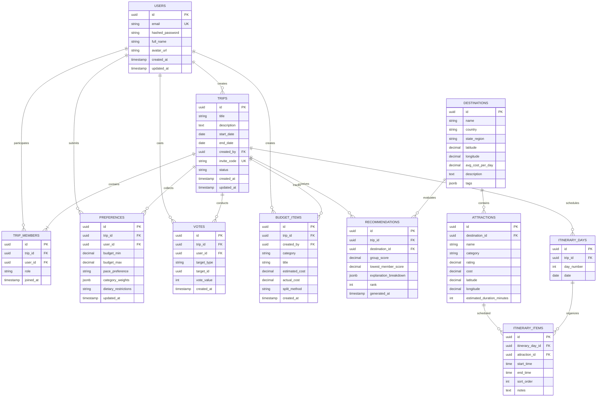

# Database Design Specification — TripSync AI

**Database Engine:** PostgreSQL 15+  
**ORM:** SQLAlchemy 2.0 (Declarative Mapping)  
**Migration Tool:** Alembic  
**Key Strategy:** UUIDv4 Primary Keys, Normalized 3NF Schema, Referential Integrity with Cascade Controls  

---

## 1. Schema Entity-Relationship Diagram

---

## 2. Table Specifications & Invariants

### 2.1 Identity & Collaboration
- **`users`:** Stores authentication credentials and user profiles. 
  - *Indexes:* Unique index on `email`.
- **`trips`:** Stores group workspaces.
  - *Indexes:* Unique index on `invite_code`, index on `created_by`.
- **`trip_members`:** Junction table for multi-user collaboration.
  - *Constraints:* Unique constraint on `(trip_id, user_id)`. Role enum `('OWNER', 'EDITOR', 'VIEWER')`.
  - *Cascade:* Deleting a trip cascades to delete trip memberships.

### 2.2 Preferences & Surveys
- **`preferences`:** Individual member constraints for a specific trip.
  - *Constraints:* Unique constraint on `(trip_id, user_id)` (one active survey per user per trip).
  - *Fields:* `category_weights` stored as structured JSONB (e.g. `{"nature": 0.8, "culture": 0.4, "adventure": 0.9}`).

### 2.3 Catalog (Destinations & Attractions)
- **`destinations`:** Regional tourism clusters (e.g., Yogyakarta, Bali, Kyoto).
  - *Indexes:* B-Tree index on `(latitude, longitude)` for spatial filtering.
- **`attractions`:** Points of interest associated with a destination.
  - *Indexes:* Foreign key index on `destination_id`, category index.

### 2.4 Decision & Execution
- **`recommendations`:** AI output snapshots for a trip.
  - *Fields:* Stores group score, minimum individual score (least misery), and ranking.
- **`votes`:** User ballots on destinations or attractions.
  - *Constraints:* Unique constraint on `(trip_id, user_id, target_type, target_id)`.
- **`budget_items` & `itinerary_days` / `itinerary_items`:** Group planning execution records with cascade deletes on trip deletion.
