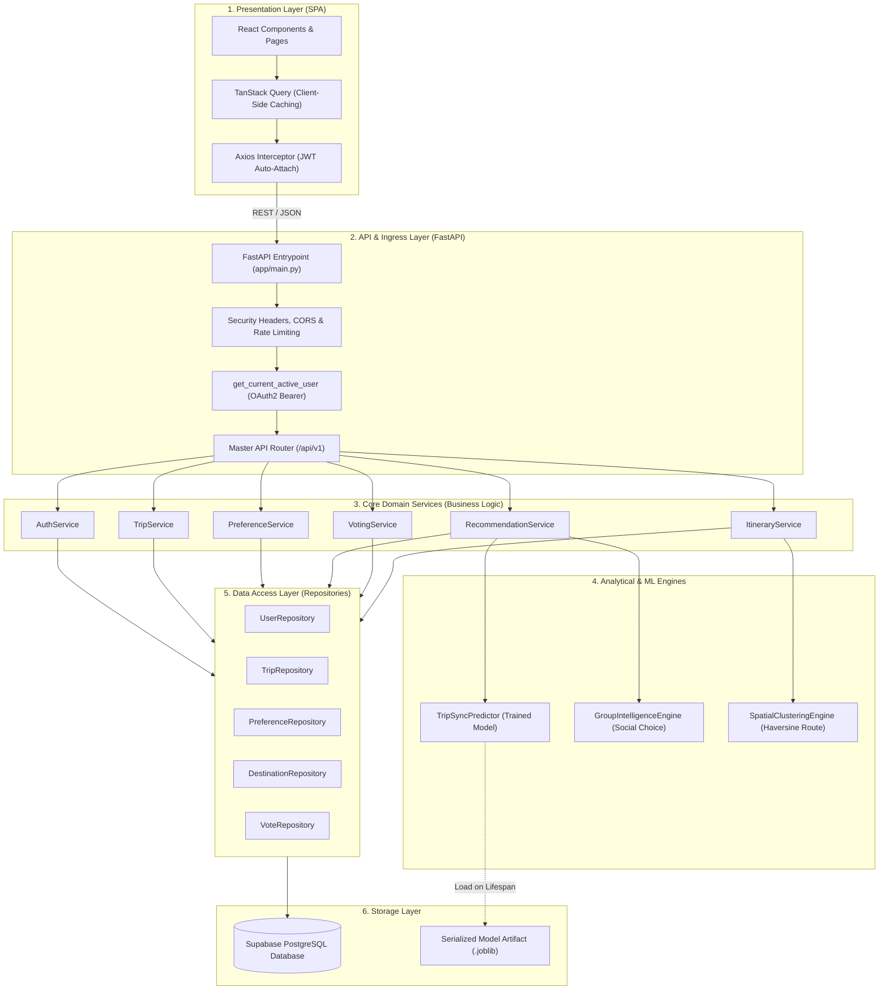
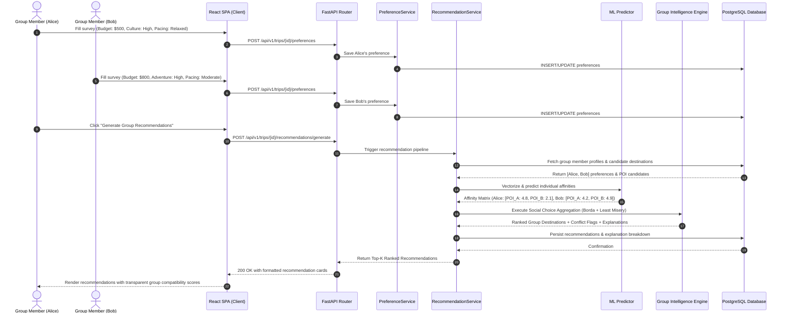

# System Architecture Document — TripSync AI

**Document Version:** 1.0.0  
**Pattern:** Domain-Centric Modular Monolith  
**Runtime:** Python 3.11 (FastAPI) + React 18 (TypeScript / Vite) + PostgreSQL 15+  

---

## 1. Architectural Strategy & Rationale

TripSync AI employs a **Domain-Centric Modular Monolith**. 

### Why Modular Monolith Over Microservices?
1. **Zero-Cost Constraint (₹0 Budget):** Microservices require multiple container runtimes, API gateways, service meshes, and distributed tracing backends, easily exceeding free-tier resource limits. A modular monolith runs comfortably in a single 512 MB RAM container.
2. **Elimination of Distributed Failure Modes:** Avoids two-phase commits, partial network partitions, and eventual consistency lag across trip planning and voting transactions.
3. **Seamless Future Portability:** Domain boundaries are strictly enforced via decoupled service interfaces and repository layers. If horizontal scale demands service extraction in the future, boundaries already exist without a code rewrite.

---

## 2. Layered Architecture & Boundaries

---

## 3. End-to-End Sequence: Group Recommendation Workflow

---

## 4. In-Memory ML Lifecycle & Resource Discipline

On a free-tier hosting instance with 512 MB RAM (e.g. Render Free), reckless model loading causes unrecoverable Out-Of-Memory (OOM) termination. We enforce the following rules:

1. **Singleton Pre-Warming at Startup:** The serialized model artifact (`model.joblib`, <25 MB) and preprocessor transforms are loaded once during FastAPI's `lifespan` startup event into an in-memory `ModelRegistry`.
2. **Zero Retraining in Web Thread:** The web API only executes feed-forward inference (matrix multiplications and tree traversals). Model retraining happens strictly offline in `ml_pipeline/`.
3. **NumPy Vectorized Inference:** Matrix computations are vectorized across the group rather than iterated through Python for-loops, maintaining inference execution times under 150 ms for a 10-person group across 100 destinations.
