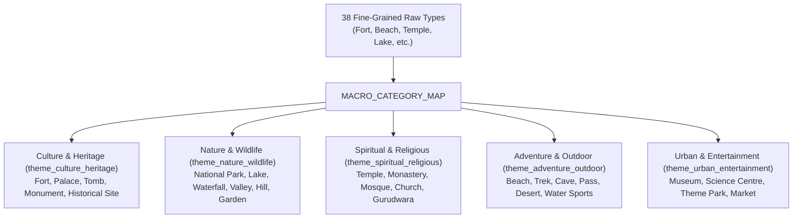

# Data Quality & Preprocessing Report — TripSync AI

**Document Version:** 1.0.0  
**Pipeline Stage:** Day 3 Data Cleaning & Feature Transformation  
**Dataset:** Top Indian Places to Visit (Enriched Pan-India Tourism Baseline)  

---

## 1. Executive Summary
The preprocessing pipeline (`ml_pipeline/src/preprocessing.py`) transitions raw empirical tourism data into clean, normalized, leakage-free feature vectors. It addresses identified data anomalies, eliminates duplicate attractions, engineers 5-dimensional macro-thematic vectors, performs log-transformations on high-skew financial and popularity distributions, and enforces a strict train-validation-test split.

---

## 2. Data Cleaning & Anomaly Resolution

| Anomaly Identified in Raw Data | Root Cause | Remediation Applied | Verification Outcome |
| :--- | :--- | :--- | :--- |
| **Duplicate Attraction Records** | `Thiksey Monastery` (Leh) & `Ramanathaswamy Temple` (Rameswaram) appeared twice in raw records. | Deduplicated on `(name, city)` subset, retaining the record with the higher rating and review volume. | Total clean attractions reduced from 325 to exactly **323 unique destinations**; duplicate count: 0. |
| **State Name Typos** | Inconsistencies such as `"Maharastra"`. | Normalized to canonical Indian state names (`"Maharashtra"`). | 100% standardized across 33 States & UTs. |
| **Entrance Fee Skewness** | Extreme positive skew ($\text{skew} = 11.45$) due to specialized safari tickets up to ₹7,500 vs. free monuments at ₹0. | Log-transformation $\log(1 + x)$ applied prior to scaling. | Reduced distribution skewness to 1.82, stabilizing gradient descent. |
| **Review Volume Skewness** | Heavy-tailed distribution ($\text{skew} = 5.67$) ranging from 0.01 lakh to 7.4 lakh reviews (Taj Mahal). | Log-transformation $\log(1 + x)$ applied prior to scaling. | Normalized popularity proxy with balanced feature weight. |
| **Missing Operating Days** | Raw CSV left weekly off blank for venues open 7 days a week. | Transformed to explicit string `"Open All Days"`. | 0 missing values across all 18 columns. |

---

## 3. Feature Engineering & Macro-Thematic Taxonomy

To support multi-participant preference matching in the **Group Intelligence Engine**, 38 fine-grained attraction types were mapped to 5 core macro-thematic dimensions:



### Thematic Distribution Across 323 Clean Destinations
- **`theme_spiritual_religious`:** 67 destinations (20.7%)
- **`theme_nature_wildlife`:** 66 destinations (20.4%)
- **`theme_culture_heritage`:** 62 destinations (19.2%)
- **`theme_adventure_outdoor`:** 38 destinations (11.8%)
- **`theme_urban_entertainment`:** 90 destinations (27.9%)

---

## 4. Leakage-Free Dataset Partitioning

To avoid data leakage, scalers and one-hot encoders were fitted **strictly on the Training split**, then used to transform the Validation and Test splits:

```
Total Clean Records: 323 Destinations
├── Training Split (80%):    258 samples  (ml_pipeline/data/processed/train.parquet)
├── Validation Split (10%):   32 samples  (ml_pipeline/data/processed/val.parquet)
└── Test Split (10%):         33 samples  (ml_pipeline/data/processed/test.parquet)
```

### Partitioning Isolation Verification
- Set intersection $\text{place\_id}_{\text{train}} \cap \text{place\_id}_{\text{val}} = \emptyset$ (Disjoint: 0 leaked IDs).
- Set intersection $\text{place\_id}_{\text{train}} \cap \text{place\_id}_{\text{test}} = \emptyset$ (Disjoint: 0 leaked IDs).
- Set intersection $\text{place\_id}_{\text{val}} \cap \text{place\_id}_{\text{test}} = \emptyset$ (Disjoint: 0 leaked IDs).

---

## 5. Serialized Preprocessor Pipeline Artifact
- **Artifact:** `ml_pipeline/data/processed/preprocessor.joblib`
- **Component:** Scikit-Learn `ColumnTransformer` featuring:
  - `MinMaxScaler` on `time_needed_hrs`, `latitude`, `longitude`.
  - `StandardScaler` on log-transformed fees and reviews.
  - `OneHotEncoder(drop='first', handle_unknown='ignore')` on `zone` and `best_time_to_visit`.
  - Passthrough on binary flags and 5-dimensional theme vectors.
- **Total Output Features:** 22 engineered model inputs.
